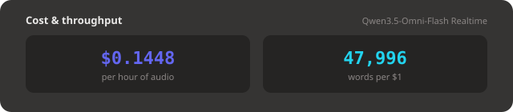

# vxbeamer

vxbeamer is a self-hosted, personal speech transcriber with a real-time web interface.

## Demo (how I use it)

I speak into my phone. The voice message is instantly transcribed. Then I can swipe on my phone to beam the transcription to my laptop.

[vxbeamer.webm](https://github.com/user-attachments/assets/ff6188ed-3d5c-4d0d-bbf1-a39916091e2a)

## Overview

For most of my transcription needs, I use [Google Gemini](https://ai.google.dev/gemini-api/docs/audio) (through the [@lsnr](https://dt.in.th/Lsnr) LINE bot) as it provides the highest accuracy. However, it comes with high latency, which makes it somewhat frustrating to use for voice typing scenarios. _(It has very high throughput though, e.g., 15 minutes of audio content can be transcribed in less than 20 seconds.)_

vxbeamer uses a different workflow: It uses [Qwen3.5 Omni](https://qwen.ai/blog?id=qwen3.5-omni) [Realtime](https://www.alibabacloud.com/help/en/model-studio/realtime) (via [Alibaba Cloud Model Studio](https://modelstudio.alibabacloud.com/)) to transcribe speech in real-time. This trades some accuracy for significantly faster feedback.

The frontend is a PWA that can be added to the home screen. Tap the record button to transcribe, swipe right to broadcast a transcription as an event (for custom integrations), and swipe left to delete it.

This project is primarily for personal use and is not designed to be particularly flexible. That said, the setup is documented.

## Documentation

The documentation is at **<https://docs.dt.in.th/vxbeamer>** (source in [`docs/`](docs/)):

- [Getting started](https://docs.dt.in.th/vxbeamer/getting-started.html): usage and deploying the backend
- [Authentication](https://docs.dt.in.th/vxbeamer/authentication.html): OIDC, pairing a client, API keys
- [Configuration](https://docs.dt.in.th/vxbeamer/configuration.html): environment variables
- [API](https://docs.dt.in.th/vxbeamer/api.html) and [model configurations](https://docs.dt.in.th/vxbeamer/asr-configurations.html)
- [`vxasr`](https://docs.dt.in.th/vxbeamer/vxasr.html) and the [ASR vendor notes](https://docs.dt.in.th/vxbeamer/asr-vendor-notes.html)
- The apps: [backend](https://docs.dt.in.th/vxbeamer/apps/backend.html), [website](https://docs.dt.in.th/vxbeamer/apps/website.html), [desktop](https://docs.dt.in.th/vxbeamer/apps/desktop.html), [Android and Wear OS](https://docs.dt.in.th/vxbeamer/apps/watch.html)

To preview them locally, run `thdocs dev` (see [thdocs](https://github.com/dtinth/thdocs)).

## Costs & Stats

